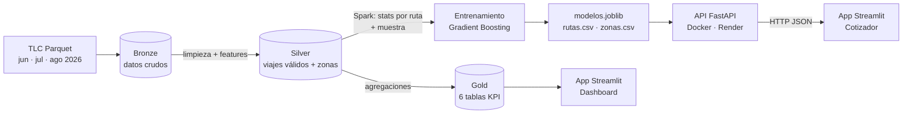

# 🚕 Taxis NYC — Pipeline Medallion + Cotizador con ML

Proyecto final de Big Data. Procesamos **más de 10 millones de viajes** de taxis amarillos de Nueva York (TLC, junio–agosto 2026) con **PySpark** usando arquitectura **Medallion (Bronze → Silver → Gold)**, entrenamos un modelo que estima **tarifa y duración** de un viaje, lo publicamos como **API REST en Docker** y lo consumimos desde una **app web** con dashboard.

| | Enlace |
|---|---|
| 🌐 App web | `https://TU-APP.streamlit.app` |
| 🔌 API (Swagger) | `https://TU-API.onrender.com/docs` |

> Equipo: Nombre 1 · Nombre 2

---

## Arquitectura



## Estructura del repositorio

```
├── notebooks/
│   ├── 01_etl_medallion.py      # Bronze, Silver, Gold (Colab + PySpark)
│   └── 02_modelo_ml.py          # features, entrenamiento, evaluación, exportación
├── api/                         # Publicación del modelo (punto 3)
│   ├── main.py                  # endpoints FastAPI
│   ├── schemas.py               # validación de entradas (Pydantic)
│   ├── predictor.py             # carga del modelo y construcción de features
│   ├── modelo/                  # artefactos exportados desde Colab
│   ├── Dockerfile
│   ├── requirements.txt
│   ├── scripts/crear_modelo_demo.py
│   └── tests/test_api.py
└── app/                         # Aplicación de consulta (punto 4)
    ├── streamlit_app.py         # cotizador + dashboard
    ├── cliente_api.py           # cliente HTTP: timeouts, reintentos, errores
    ├── data/                    # CSV de la capa Gold
    └── tests/test_cliente_api.py
```

## 1. Datos y limpieza (Medallion)

**Fuente:** [NYC TLC Trip Record Data](https://www.nyc.gov/site/tlc/about/tlc-trip-record-data.page) — Yellow Taxi, junio, julio y agosto 2026 + `taxi_zone_lookup.csv`.

| Capa | Contenido | Registros |
|---|---|---|
| Bronze | Los 3 parquet unidos, sin cambios | `[completar]` |
| Silver | Viajes válidos + columnas derivadas + nombres de zonas | `[completar]` |
| Gold | 6 tablas agregadas para el dashboard | — |

Reglas de limpieza en Silver y su justificación:

| Regla | Por qué |
|---|---|
| Quitar nulos en fechas, zonas y `fare_amount` | Sin ellas no se puede calcular duración ni ubicar el viaje |
| Fechas fuera de 2026-06-01 – 2026-08-31 | Los archivos TLC traen viajes con fechas erróneas (otros años) |
| `trip_distance` ≤ 0 o ≥ 100 millas | Errores del taxímetro; un viaje en NYC no recorre 100 mi |
| `fare_amount` ≤ 0, `total_amount` ≤ 0 | Reembolsos/ajustes contables, no viajes reales |
| `passenger_count` ≤ 0 | Captura incorrecta del conductor |
| `dropoff` ≤ `pickup` | Imposible físicamente |
| Duración < 1 min o > 180 min | Viajes cancelados o taxímetro olvidado encendido |

Columnas derivadas: `duracion_min`, `fecha`, `hora`, `dia_semana`, `mes`, y `borough/zona` de origen y destino (join con el catálogo).

Tablas Gold: viajes por hora · ingresos por zona · propinas por día (solo tarjeta, en efectivo no se registran) · resumen diario · rutas entre boroughs · método de pago.

## 2. Problema de ML y métricas

- **Tarea:** regresión. Dado *origen, destino, hora, día de la semana y pasajeros*, estimar **(a)** la tarifa base `fare_amount` (USD) y **(b)** la duración del viaje (min). Son los datos que un usuario conoce **antes** de subir al taxi.
- **Métrica principal: MAE** (error absoluto medio). Se interpreta directo ("nos equivocamos en promedio ±$X / ±Y min") y es menos sensible que el RMSE a los viajes extremos que quedan en la cola. Reportamos también RMSE y R².
- **Baseline:** la mediana histórica de la ruta. El modelo debe superarla para justificar su uso.
- **Validación temporal:** entrenamos con **junio–julio** y evaluamos con **agosto**, simulando predecir el futuro sin fuga de información. Las estadísticas por ruta se calculan solo con datos de entrenamiento.

**Features**

| Feature | Origen |
|---|---|
| `PULocationID`, `DOLocationID` | ID de zona |
| `borough_origen_cod`, `borough_destino_cod` | categórica (6 boroughs) |
| `hora`, `dia_num`, `passenger_count` | del viaje |
| `dist_ruta`, `dur_ruta`, `log_n_ruta` | mediana de distancia/duración y nº de viajes por par origen-destino, **calculados con Spark sobre todo el periodo de entrenamiento** (rutas con ≥ 20 viajes) |

**Modelo:** `HistGradientBoostingRegressor` (scikit-learn), uno por objetivo, con early stopping. Se entrena con una muestra aleatoria de 1.5 M viajes (el ETL y las features de ruta usan el 100 % de los datos en Spark).

**Resultados en agosto 2026 (test)** — copiar de `api/modelo/metadata.json`

| Objetivo | Modelo MAE | Baseline MAE | Modelo RMSE | Modelo R² |
|---|---|---|---|---|
| Tarifa (USD) | `[ ]` | `[ ]` | `[ ]` | `[ ]` |
| Duración (min) | `[ ]` | `[ ]` | `[ ]` | `[ ]` |

## 3. Publicación del modelo (API)

API REST con **FastAPI**, empaquetada en **Docker** y desplegada en **Render**. Documentación automática **OpenAPI/Swagger** en `/docs` (y ReDoc en `/redoc`).

| Método | Ruta | Descripción |
|---|---|---|
| GET | `/health` | Estado del servicio, versión y métricas del modelo |
| GET | `/zonas` | Catálogo de zonas válidas (id, zona, borough) |
| POST | `/predict` | Cotiza un viaje |
| POST | `/predict/lote` | Cotiza de 1 a 100 viajes |

**Validación de entradas** (Pydantic → HTTP 422 con detalle por campo): IDs entre 1 y 263 y existentes en el catálogo · hora 0–23 · día de la semana de una lista cerrada (acepta acentos/mayúsculas) · pasajeros 1–6 · se rechazan campos desconocidos · lotes de 1 a 100. Errores internos devuelven 500 con mensaje genérico (sin exponer trazas) y quedan en el log; si el modelo no cargó, `/health` y `/predict` responden 503. Opcionalmente se protege con header `X-API-Key` (variable `API_KEY`).

Ejemplo:

```bash
curl -X POST https://TU-API.onrender.com/predict \
  -H "Content-Type: application/json" \
  -d '{"origen_id": 132, "destino_id": 230, "hora": 18, "dia_semana": "viernes", "pasajeros": 1}'
```

```json
{
  "tarifa_estimada_usd": 70.0,
  "duracion_estimada_min": 52.4,
  "distancia_ruta_millas": 17.1,
  "ruta_conocida": true,
  "viajes_historicos_ruta": 18234,
  "origen":  {"id": 132, "zona": "JFK Airport", "borough": "Queens"},
  "destino": {"id": 230, "zona": "Times Sq/Theatre District", "borough": "Manhattan"},
  "modelo_version": "20261119-1530"
}
```
*(valores ilustrativos)*

## 4. Aplicación de consulta

App en **Streamlit** (Community Cloud) con dos pestañas:

1. **Cotizador:** el usuario elige borough/zona de origen y destino, hora, día y pasajeros; la app llama a `POST /predict` del endpoint publicado. **La app no contiene el modelo**: solo conoce la URL (`API_URL` en *secrets*). El catálogo de zonas también viene de la API (`GET /zonas`).
2. **Dashboard:** gráficas de las tablas Gold.

Manejo de fallos en `app/cliente_api.py`:

| Situación | Cómo se maneja |
|---|---|
| Servidor dormido / lento | Timeout de conexión 5 s y de lectura 30 s, mensaje sugiriendo reintentar |
| 502 / 503 / 504, conexión caída | Hasta 2 reintentos con backoff exponencial |
| 422 | Se traduce el detalle de FastAPI a un mensaje legible por campo |
| 401 / 403 | Mensaje de credencial inválida |
| 5xx | Mensaje de error del servidor, sin romper la app |
| Respuesta no-JSON, campos faltantes, valores no numéricos o fuera de rango | Se valida la respuesta antes de mostrarla |
| API caída al cargar zonas | Botón *Reintentar*; el dashboard sigue funcionando |

Todos estos casos están cubiertos por pruebas automáticas contra un servidor falso (`app/tests`).

## Cómo ejecutarlo

```bash
# API
cd api
pip install -r requirements-dev.txt
pytest -q                                   # pruebas con modelo sintético
uvicorn main:app --reload                   # http://localhost:8000/docs

# o con Docker
docker build -t taxis-api ./api
docker run -p 8000:8000 taxis-api

# App
cd app
pip install -r requirements.txt pytest
pytest -q tests
API_URL=http://localhost:8000 streamlit run streamlit_app.py
```

## Tecnologías

PySpark · Google Colab · Google Drive · scikit-learn · FastAPI · Pydantic · Docker · Render · Streamlit · pytest

## Limitaciones y trabajo futuro

- Se predice la tarifa **base**; peajes, propina y recargos (congestión, aeropuerto) no se incluyen.
- Solo datos de verano 2026: la estacionalidad (invierno, fiestas) no está capturada.
- Rutas con < 20 viajes usan solo las variables generales del modelo (la app lo advierte).
- Siguiente paso: orquestar el pipeline como job programado (Databricks Jobs / Airflow) y reentrenar mensualmente.
